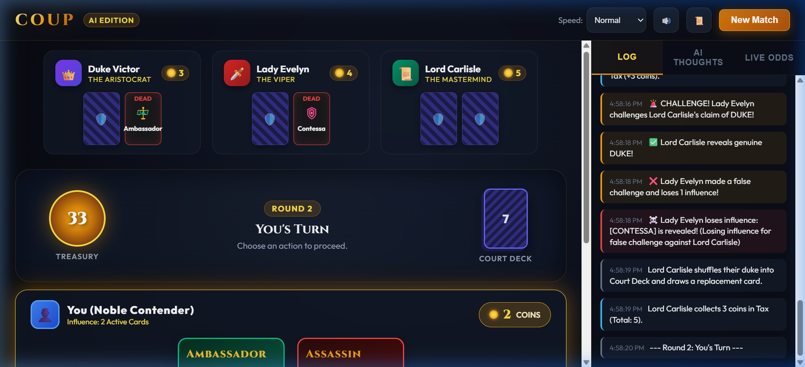

# Coup AI - Court of Deception

[](https://tienpham4812.github.io/coup-ai/)
[](https://opensource.org/licenses/MIT)

A web-based digital edition of the bluffing, bribery, and deduction board game **Coup**, built with modern Vanilla JavaScript, CSS3 design systems, and autonomous AI agents.

🎮 **[Play Live Now in Your Browser](https://tienpham4812.github.io/coup-ai/)**



---

## 🎭 Game Features

### 1. Complete Official Coup Rules & Mechanics
- **Court Deck of 15 Cards**: 3 copies each of **Duke**, **Assassin**, **Captain**, **Ambassador**, and **Contessa**.
- **General Actions**:
  - `Income`: Take 1 coin from the Treasury (unblockable & unchallengeable).
  - `Foreign Aid`: Take 2 coins from the Treasury (can be blocked by Duke).
  - `Coup`: Pay 7 coins to force an opponent to sacrifice 1 influence (unblockable & unchallengeable).
  - **Mandatory Coup Rule**: Players starting their turn with 10 or more coins must Coup!
- **Character Actions**:
  - `Tax` (Duke): Take 3 coins from Treasury.
  - `Assassinate` (Assassin): Pay 3 coins to eliminate an opponent's influence (blocked by Contessa).
  - `Steal` (Captain): Steal 2 coins from another player (blocked by Captain or Ambassador).
  - `Exchange` (Ambassador): Draw 2 cards from the deck, choose which to keep, and return 2.
- **Counteractions & Blocks**:
  - Block Foreign Aid (Duke)
  - Block Assassination (Contessa)
  - Block Stealing (Captain or Ambassador)
- **Bluffing & Challenge Resolution**:
  - Players can claim any character or counteraction even without holding the card.
  - Interactive challenge countdown windows for all players.
  - Truthful players reveal their card, reshuffle it for a new card, and challenger loses 1 influence.
  - Caught bluffers lose 1 influence and their action or block fails.
  - Proper handling of the double-kill rule (assassination + failed Contessa bluff).

---

### 2. Intelligent AI Opponents & Personalities
- **Duke Victor (The Aristocrat)**: Cautious bluffer who taxes diligently and challenges obvious falsehoods.
- **Lady Evelyn (The Viper)**: Ruthless and aggressive, rushes assassinations, bluffs daringly.
- **Lord Carlisle (The Mastermind)**: Pure card counter. Uses hypergeometric distributions to compute exact mathematical probabilities before challenging.
- **Rogue Silas (The Gambler)**: High-stakes bluffer, loves counter-attacks and unpredictable steals.
- **AI Thought Inspector**: A dedicated live stream panel revealing the internal monologue, probability calculations, and decision rationales of AI players.
- **Live Card Counting Tracker**: Visual breakdown tracking known cards, dead cards, and unseen card pools in real time.

---

### 3. Audiovisual Immersion
- **Venetian Noir Aesthetic**: Dark royal obsidian palette, gold foil accents, glassmorphism, 3D card tilts, and custom vector character illustrations.
- **Web Audio API Procedural Synthesizer**: No external audio assets needed! Procedural coin chimes, tension bells, dagger slashes, shield deflections, and victory fanfares.
- **Animation Controls**: Speed selector (`Fast`, `Normal`, `Cinematic`).

---

## 🚀 How to Run Locally

1. Open your terminal in this repository.
2. Run any local HTTP server, for example with Python:
   ```bash
   python -m http.server 8085
   ```
3. Open your browser and navigate to:
   ```
   http://localhost:8085
   ```

---

## 📁 Project Architecture

```
coup-ai/
├── index.html               # Main semantic HTML5 interface
├── styles/
│   └── main.css             # Glassmorphism, animations, gold accents & typography
├── js/
│   ├── app.js               # Application bootstrap
│   ├── models/
│   │   ├── Card.js          # Card roles, character abilities, SVG artwork templates
│   │   ├── Deck.js          # Court deck management & Fisher-Yates shuffling
│   │   └── Player.js        # Player state, coin counts & AI archetypes
│   ├── engine/
│   │   └── GameEngine.js    # Core state machine (turns, challenges, blocks, resolution)
│   ├── ai/
│   │   └── CoupAI.js        # AI decision brain with hypergeometric probability engine
│   ├── audio/
│   │   └── SoundFX.js       # Procedural Web Audio API sound synthesis
│   └── ui/
│       └── UIController.js  # DOM rendering, interactive modals, and timers
└── README.md
```
